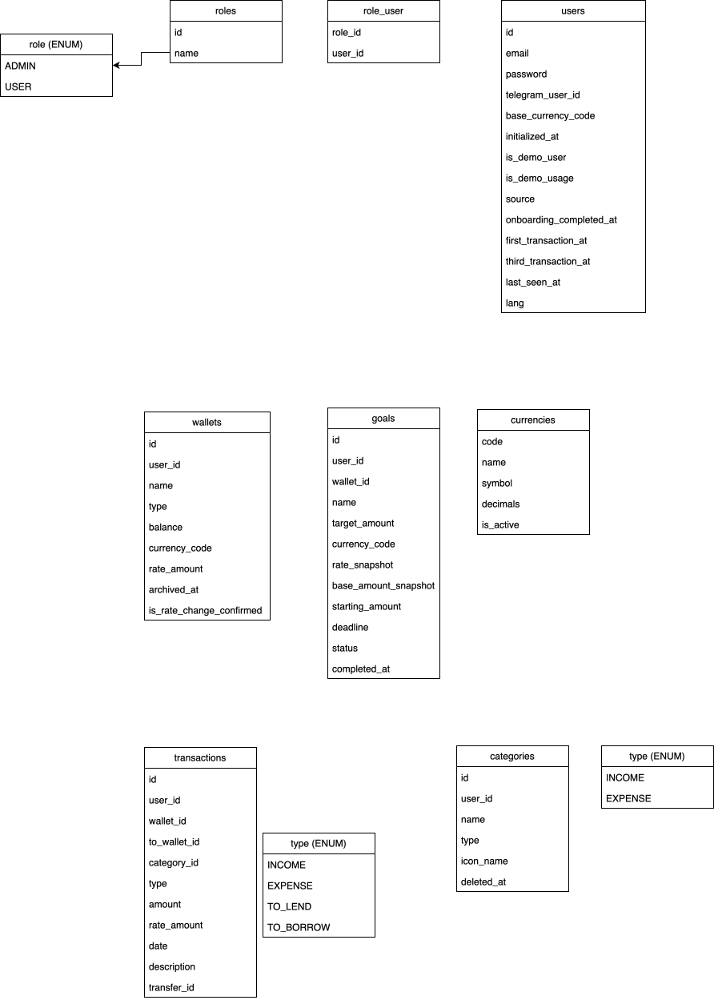

# MoneyFlow API

Backend service for **MoneyFlow**, a personal finance tracker. It manages multi-currency wallets, income / expense / transfer transactions, categories, savings goals, statistics, and transaction exports (CSV and PDF). Users sign in with email and password or through a Telegram Mini App, and new users can explore the app in a read-only demo mode before setting up their own account.

## Table of Contents

- [Features](#features)
- [Tech Stack](#tech-stack)
- [Database Schema](#database-schema)
- [Architecture](#architecture)
- [Getting Started](#getting-started)
- [Configuration Reference](#configuration-reference)
- [Authentication](#authentication)
- [Demo Mode](#demo-mode)
- [Exports](#exports)
- [API Documentation](#api-documentation)
- [Project Structure](#project-structure)
- [Development](#development)

## Features

- **Authentication**: JWT access tokens, email / password login, Telegram Mini App login, role-based authorities
- **Wallets**: multiple wallets per user, each with its own currency, balance, and exchange rate; archiving support
- **Transactions**: income, expense, and transfers between wallets with a conversion rate for cross-currency transfers
- **Categories**: user-defined income and expense categories with icons, usage tracking, and soft deletion
- **Goals**: savings goals linked to wallets with target amount, deadline, and status
- **Statistics**:
  - income vs. expense series by week, month, or year
  - category totals by type
  - monthly totals
  - period-over-period differences
  - daily totals for a date range
- **Transaction feed**: paginated feed filtered by date range
- **Demo mode**: new users browse prepared demo data until they start their own account
- **Exports**: asynchronous CSV (zipped) and PDF exports delivered through short-lived signed links
- **Telegram integration**: bot webhook and Telegram-based authentication
- **Operations**: Flyway migrations, Actuator health endpoint, Swagger UI

## Tech Stack

| Layer            | Technology                                       |
|------------------|--------------------------------------------------|
| Language         | Java 21                                          |
| Framework        | Spring Boot 4.1.1 (Web MVC, Data JPA, Security, Validation, Actuator) |
| Database         | PostgreSQL 17                                    |
| Migrations       | Flyway                                           |
| Authentication   | JWT (JJWT 0.13.0)                                |
| API docs         | springdoc-openapi (Swagger UI)                   |
| PDF generation   | OpenPDF with embedded Noto Sans font             |
| Telegram         | telegram-bot-spring-boot                         |
| Boilerplate      | Lombok                                           |
| Testing          | Spring Boot test starters, Spring Security Test, H2 |
| Infrastructure   | Docker, Docker Compose, Nginx                    |

## Database Schema



## Architecture

```
Client ──► Nginx (:8080) ──► Spring Boot app (:8085) ──► PostgreSQL (:5432)
              │                       │
              │                       └── writes export files ──┐
              │                                                 ▼
              └──── serves protected files (X-Accel-Redirect) ◄─ exports volume
```

| Service    | Container          | Description                                       | Port             |
|------------|--------------------|---------------------------------------------------|------------------|
| `postgres` | `money_flow_db`    | PostgreSQL 17 with tuned memory settings          | `5433` → `5432`  |
| `app`      | `money_flow_app`   | Spring Boot REST API                              | internal `8085`  |
| `nginx`    | `money_flow_nginx` | Reverse proxy and protected export file server    | `8080` → `80`    |

The `app` and `nginx` containers share the `exports_data` volume. The application writes generated export files there, and Nginx serves them after the application authorizes the download.

## Getting Started

### Prerequisites

- Docker 24+ with Docker Compose v2
- A Telegram bot token (required for Telegram login and the bot webhook)

### 1. Clone the repository

```bash
git clone https://github.com/solmosov/money-flow-api
cd money-flow-api
```

### 2. Create the `.env` file

```env
POSTGRES_USER=moneyflow
POSTGRES_PASSWORD=change_me
POSTGRES_DB=moneyflow

SPRING_PROFILES_ACTIVE=prod
SERVER_PORT=8085

DB_URL=jdbc:postgresql://postgres:5432/moneyflow
DB_USERNAME=moneyflow
DB_PASSWORD=change_me

JWT_SECRET_KEY=replace_with_a_random_string_of_at_least_32_characters
TELEGRAM_BOT_TOKEN=your_telegram_bot_token
APP_EXPORT_LINK_SECRET=replace_with_another_random_secret
```

Notes:

- `DB_USERNAME`, `DB_PASSWORD`, and the database name in `DB_URL` must match the `POSTGRES_*` values.
- `JWT_SECRET_KEY` is used as an HMAC key, so it must be at least 32 bytes long.
- `SERVER_PORT` must be `8085` to match the Compose and Nginx setup.

### 3. Create the Nginx config

Compose mounts `./nginx/default.conf` into the Nginx container. The export download flow relies on an `internal` location that the application targets through the `X-Accel-Redirect` header:

```nginx
server {
    listen 80;

    location = /actuator/health {
        proxy_pass http://app:8085;
        proxy_set_header Host $host;
    }

    location /actuator/ {
        allow 127.0.0.1;
        deny all;
        proxy_pass http://app:8085;
    }

    location / {
        proxy_pass http://app:8085;
        proxy_set_header Host $host;
        proxy_set_header X-Real-IP $remote_addr;
        proxy_set_header X-Forwarded-For $proxy_add_x_forwarded_for;
        proxy_set_header X-Forwarded-Proto $scheme;
        proxy_http_version 1.1;
        proxy_read_timeout 300s;
    }

    location /protected-exports/ {
        internal;
        alias /var/app/exports/;
        sendfile on;
        gzip off;
        limit_rate 5m;
    }
}
```

If you expose WebSocket endpoints under `/ws/**`, add the usual `Upgrade` and `Connection` proxy headers for that path.

### 4. Build and run

```bash
docker compose up -d --build
```

The API is available at `http://localhost:8080`.

### 5. Verify

```bash
curl http://localhost:8080/actuator/health
```

### Useful commands

```bash
docker compose ps
docker compose logs -f app
docker compose restart app
docker compose down
docker compose down -v
```

`docker compose down -v` also deletes the database and export volumes.

## Configuration Reference

### Environment variables

| Variable                                       | Description                                              |
|------------------------------------------------|----------------------------------------------------------|
| `POSTGRES_USER`, `POSTGRES_PASSWORD`, `POSTGRES_DB` | PostgreSQL container credentials and database name  |
| `SPRING_PROFILES_ACTIVE`                       | Active Spring profile                                    |
| `SERVER_PORT`                                  | Application port (`8085`)                                |
| `DB_URL`, `DB_USERNAME`, `DB_PASSWORD`         | Application database connection                          |
| `JWT_SECRET_KEY`                               | HMAC secret used to sign JWT tokens                      |
| `TELEGRAM_BOT_TOKEN`                           | Telegram bot token                                       |
| `APP_EXPORT_DIR`                               | Export directory in the container (preset to `/var/app/exports`) |
| `APP_EXPORT_LINK_SECRET`                       | Secret used to sign export download links                |
| `SPRING_DATASOURCE_HIKARI_MAXIMUM_POOL_SIZE`   | Database pool size (preset to `10`)                      |
| `JAVA_TOOL_OPTIONS`                            | JVM options (preset heap and CPU settings)               |

### Application properties

JWT behavior is controlled by these properties, which are mapped from your configuration or environment:

| Property                                  | Description                         |
|-------------------------------------------|-------------------------------------|
| `app.security.jwt.secret-key`             | Signing key                         |
| `app.security.jwt.access-token-expiration`  | Access token lifetime in milliseconds |
| `app.security.jwt.refresh-token-expiration` | Refresh token lifetime in milliseconds |

### Resource limits

| Service    | CPU  | Memory |
|------------|------|--------|
| `postgres` | 0.75 | 1 GB   |
| `app`      | 1.0  | 2 GB   |
| `nginx`    | 0.25 | 128 MB |

## Authentication

All endpoints require a `Bearer` token except the public ones.

| Method | Endpoint                 | Description                                   |
|--------|--------------------------|-----------------------------------------------|
| POST   | `/api/v1/auth/telegram`  | Login with Telegram Mini App `initData`       |

Tokens are signed JWTs. The subject is the user ID, and the claims carry the email or Telegram user ID and an optional customer ID. On every request the `JwtFilter` loads the user, builds a `CustomUserPrincipal`, and records whether the account is initialized and whether it is in demo mode.

Other public paths: `/actuator/health`, `/swagger-ui/**`, `/v3/api-docs/**`, `/webhook/telegram/**`, `/ws/**`, and `/api/v1/exports/*/file` (protected by a signed link instead of a token).

## Demo Mode

New users start in demo mode (`isDemoUsage`). While in this mode:

- Requests are served from a shared demo user chosen from the `Accept-Language` header, so the real account stays untouched.
- Only a whitelist of mostly read-only endpoints is allowed: currencies, categories, wallets, transactions, goals, profile, and user-account actions.
- Calling `POST /api/v1/user-account/start` initializes the real account and leaves demo mode.
- `DELETE /api/v1/user-account/demo-data` removes demo data, and `DELETE /api/v1/user-account` deletes the account (confirmed through a deletion code).

Accounts that are not yet initialized can only reach the public endpoints, the currency endpoints, and `/api/v1/user-account/start`.

## Exports

Exports run asynchronously so large histories do not block requests.

| Step | Request                                | Description                                              |
|------|----------------------------------------|----------------------------------------------------------|
| 1    | `POST /api/v1/exports`                 | Create an export job and receive its ID (`202 Accepted`) |
| 2    | `GET /api/v1/exports/{id}/status`      | Poll the job status                                      |
| 3    | `POST /api/v1/exports/{id}/link`       | Get a signed download URL valid for 10 minutes           |
| 4    | `GET /api/v1/exports/{id}/file?exp&sig` | Download the file                                       |

Details:

- Request body: `from`, `to`, and `format` (`CSV` or `PDF`). Send the `X-Timezone` header (default `UTC`) so dates are rendered in the user's time zone.
- Identical requests are reused instead of creating duplicate jobs.
- If the executor queue is full, the job is marked failed and the API returns a "too many requests" error.
- CSV exports are zipped, UTF-8 with BOM, and sanitized against spreadsheet formula injection.
- PDF exports use an embedded Noto Sans font, so Cyrillic and other scripts render correctly.
- Columns: `date`, `time_zone`, `wallet_name`, `wallet_type`, `category_name`, `type`, `currency`, `amount`, `rate_amount`, `description`, `raw_date`.
- Download links are signed with `APP_EXPORT_LINK_SECRET`. After verification, the app responds with `X-Accel-Redirect` and Nginx streams the file from the exports volume.

## API Documentation

Interactive documentation is available once the app is running:

- Swagger UI: `http://localhost:8080/swagger-ui.html`
- OpenAPI JSON: `http://localhost:8080/v3/api-docs`

## Project Structure

```
com.example.moneyflowapi
├── auth            login, Telegram authentication
├── category        categories and category types
├── common          shared base entity and utilities
├── currency        currencies and currency codes
├── demo            demo user resolution
├── exception       business exceptions and error codes
├── export          export jobs, writers (CSV, PDF), signed links
├── goal            savings goals
├── role            user roles
├── security        security config, constants, JWT filter and service
├── transaction     transactions, statistics, DTOs, projections, mappers
├── user            users and user account management
└── wallet          wallets and balance management
```

## Data Model Overview

| Entity       | Key fields                                                                                  |
|--------------|---------------------------------------------------------------------------------------------|
| `User`       | email, password, Telegram user ID, base currency, language, demo flags, onboarding timestamps, roles |
| `Role`       | name                                                                                        |
| `Wallet`     | user, name, type, balance, currency, rate amount, archived date, rate-change confirmation   |
| `Category`   | user, name, type (`INCOME` / `EXPENSE`), icon, last used date, soft-delete date             |
| `Transaction`| user, wallet, optional target wallet, category, type, amount, target amount, rate, currency, date, description |
| `Goal`       | user, wallet, name, target amount, currency, snapshots, starting amount, deadline, status, completion date |
| `Currency`   | code, name, symbol, decimals, active and popular flags                                      |
| `ExportJob`  | user, status, date range, time zone, format, file info, error message, expiry               |

Business rules worth knowing:

- Balance-changing operations run in database transactions and lock the wallet row to prevent race conditions.
- Archived wallets cannot be modified.
- Transfers fail when the source wallet balance is insufficient.
- Deleting a transaction reverses its effect on wallet balances.
- Daily totals are limited to a 20-day range.

## Development

Requirements: JDK 21 and Maven (or the included wrapper, if present).

```bash
mvn clean package
mvn spring-boot:run
mvn test
```

The build produces `target/app.jar`. Running locally requires a PostgreSQL instance and the environment variables listed above.